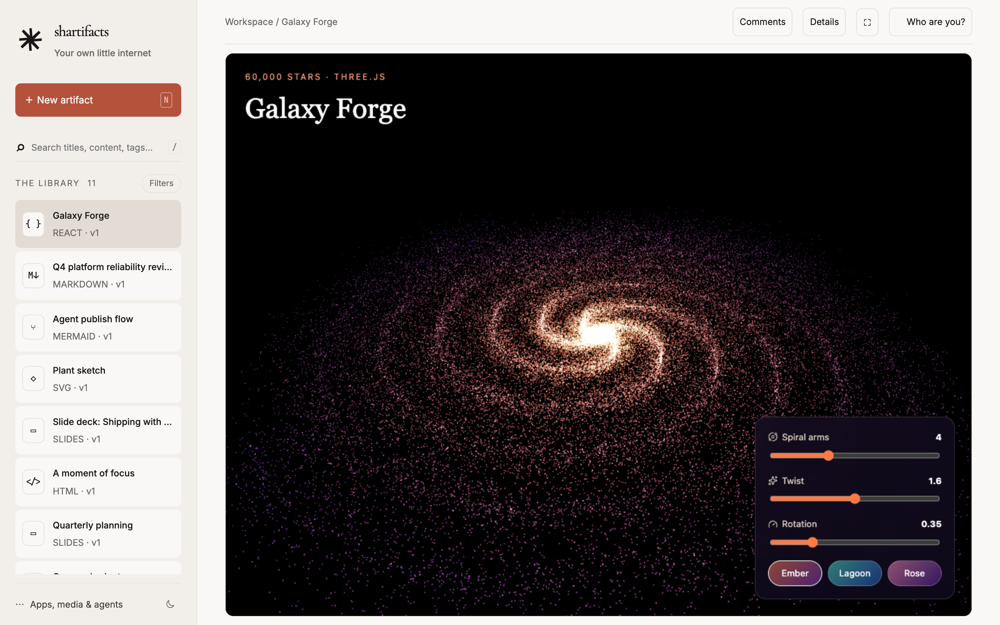
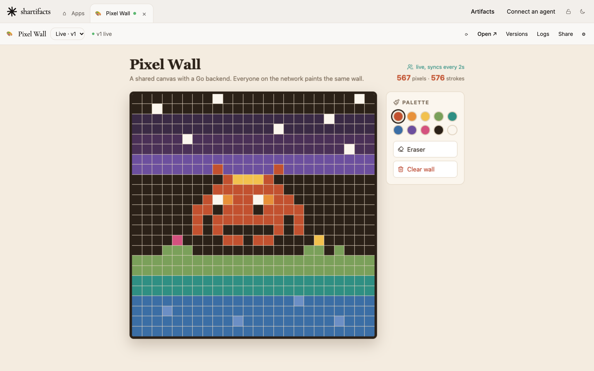

# shartifacts

**A self-hosted home for the things you and your AI agents make.**

shartifacts is a small server you run once (on a home server, a NAS, a VPS or your own laptop) that gives your coding agents a place to put what they build: interactive HTML and React artifacts, documents, slide decks, diagrams, and full-stack apps with their own backend. Agents connect over MCP. You open what they made in a browser on any of your devices, change it, keep every version, and, if you want, share a read-only link with anyone.



> [!IMPORTANT]
> **This is an opinionated personal project, not a product.** I built shartifacts for my own setup (a home server, a tailnet, a few coding agents, and a handful of public share links) and I maintain it for that use case only. It's public so you can borrow from it, not because it aims to suit everyone.
>
> - **Fork it, or hand it to your coding agent as context.** Point Claude Code, Codex or Cursor at this repo, tell it what you want, and let it take the parts you like and change the rest. That is the intended way to use it.
> - **No support or roadmap promised.** Issues and pull requests may sit unanswered or be closed if they don't fit how I use it. Features I don't need are unlikely to land here. Your fork is the place for them.
> - **Defaults reflect my choices**: Go and plain JavaScript, files in one folder instead of a database, Docker Compose, Tailscale, Cloudflare or Caddy for sharing, the Claude artifact runtime as the compatibility target. Expect to change them.
> - **It stays secure by design, but you own your deployment.** Read [docs/security.md](docs/security.md) before exposing anything.

## Use it your way

Three reasonable ways to use this repo, in order of how much I'd suggest them:

1. **Adapt it with an agent.** Open your agent in a clone and give it a prompt like this:

   ```text
   Read AGENTS.md, README.md and docs/. This is shartifacts, an opinionated
   self-hosted artifact server built for one person's setup. I want my own
   version of it: <what you want to keep, drop or change>. Plan the changes
   first, keep the security model in docs/security.md intact unless I say
   otherwise, and run the checks in AGENTS.md before you finish.
   ```

2. **Fork and maintain your own.** The code is a small Go server with an embedded plain-JavaScript UI and no framework to learn. [docs/development.md](docs/development.md) has the layout and test commands, and [AGENTS.md](AGENTS.md) has the conventions.
3. **Run it as is.** If my defaults happen to suit you, the setup below works, and the docs describe every setting. Just don't count on me to change it for you.

## What it does

- **Made for agents.** A built-in MCP server lets Claude Code, Codex, Cursor and other agents create, edit, search and comment on artifacts and deploy apps. Artifacts written for Claude run unchanged: the same React libraries, shadcn/ui, Tailwind, `window.storage` and `claude.use(...)` capabilities.
- **Apps that run.** Full-stack micro frontends: a React/TypeScript frontend with a Go (or prebuilt Rust) backend and its own data, deployed as versions you can preview and roll back, each open in a tab.


- **Private by default.** No cloud, no telemetry, no CDNs. It works offline. The workspace answers only your own network and tailnet, and an optional owner password, with a revocable token per agent, keeps out the people and devices on it you don't trust.
- **Share when you want to.** Give it a hostname of your own and it serves read-only artifact links and public app links there, and nothing else.
- **One process, one folder.** A single Go binary (or two small containers) keeps everything as plain files in one data folder you back up.

## Set up with your agent

If you want to run it as is, the quickest way is to let your coding agent do it. Open Claude Code, Codex, Cursor or a similar agent on the machine that will run shartifacts, or on one that can SSH into it, and paste this:

```text
Set up shartifacts for me (https://github.com/LaneBirmingham/shartifacts).
Clone the repository and follow skills/shartifacts-setup/SKILL.md: ask me the
questions it lists before changing anything, then install it, check that it
works, and connect yourself to it over MCP.
```

The agent asks a few questions: where shartifacts should run, who should reach it, whether you want public sharing, and, if so, which domain and DNS provider you use. Then it installs shartifacts, verifies it and connects itself. If public sharing needs DNS records, a Cloudflare tunnel or a Caddy proxy, the agent sets those up as well, after asking you first. The [setup skill](skills/shartifacts-setup/SKILL.md) is plain Markdown, so you can read exactly what it will do.

## Or set it up yourself

You need Docker with Compose. To run it on this machine only:

```sh
git clone https://github.com/LaneBirmingham/shartifacts.git
cd shartifacts
docker compose up -d --build
```

Open <http://localhost:8080>, and connect your agent to `http://localhost:8080/mcp`.

To open it from other devices on your network, copy the example settings and set `SHARTIFACTS_BIND` to `0.0.0.0` in `.env` (or to this machine's LAN IP), then run `docker compose up -d` again:

```sh
cp .env.example .env
```

Without Docker, you need Go 1.26 or newer: `go build -o bin/shartifacts . && ./bin/shartifacts`. [docs/install.md](docs/install.md) covers both ways in full, along with upgrades, backups and platform notes (Unraid, Raspberry Pi, macOS, VPS).

## Choose a mode

| Mode | What you get | What you need |
| --- | --- | --- |
| **Private** (default) | The workspace and MCP on your machine or home network, and anywhere through Tailscale. Nothing is public. | Docker. Tailscale if you want remote access and HTTPS. |
| **Public sharing** | Everything above, plus read-only artifact links and public app links on `share.your-domain`. The workspace stays private. | A domain of your own and a server the internet can reach on ports 80 and 443. The bundled Caddy gets certificates automatically. |
| **Public sharing via a provider** | The same, with the public side run by Cloudflare Tunnel (no open ports, which suits a home connection) or by a reverse proxy you already have. | An account with the provider. Your agent can drive its API for you. |

[docs/modes.md](docs/modes.md) explains each mode and gives the exact settings for it.

## Connect an agent

**Connect an agent** in the web UI shows your server's address and the commands to copy. For example:

```sh
claude mcp add --transport http shartifacts http://192.168.1.20:8080/mcp   # Claude Code
codex mcp add shartifacts --url http://192.168.1.20:8080/mcp               # Codex
```

Then ask your agent for something, such as *"make me an interactive packing checklist in shartifacts"* or *"build a small expenses app with a Go backend in shartifacts"*. [docs/agents.md](docs/agents.md) covers other clients and the full set of MCP tools.

## Security in one paragraph

The workspace accepts only loopback, private-network and Tailscale clients, because anyone who can use it can read, change and delete everything. Sign-in is optional on top of that: set an owner password and browsers sign in once, while agents send a token you can revoke. It checks Host, Origin and Fetch Metadata headers against DNS rebinding and cross-site requests. It also refuses requests that a reverse proxy forwards from the internet. Public sharing uses a separate hostname, on which the server answers nothing except share pages. Artifacts and app pages run in an opaque-origin sandbox, and app backends run in a sidecar container that can see only the apps folder. Read [docs/security.md](docs/security.md) before exposing anything, and [SECURITY.md](SECURITY.md) to report a vulnerability.

## Documentation

- [Modes](docs/modes.md): private, public sharing, and public sharing through a provider
- [Install and operate](docs/install.md): Docker, the binary, upgrades, backups, platforms
- [Configuration](docs/configuration.md): every setting
- [Public sharing](docs/sharing.md): share links, app hostnames, DNS, Caddy, Cloudflare
- [Reverse proxies](docs/reverse-proxies.md): tailscale serve, nginx, Nginx Proxy Manager, Traefik
- [Agents and MCP](docs/agents.md): client setup and the MCP tools
- [Artifacts](docs/artifacts.md): kinds, editing, search, the default design, storage
- [Claude compatibility](docs/claude-compatibility.md): source written for Claude, and the `claude.use` runtime
- [Media and data files](docs/media.md): uploads, embedding, limits
- [Apps](docs/apps.md): the full-stack app contract, deploys and the runner
- [HTTP API](docs/http-api.md)
- [Security model](docs/security.md)
- [Development](docs/development.md): building, tests and code layout

## Contributing

Read [CONTRIBUTING.md](CONTRIBUTING.md) first. In short: bug reports and small fixes are welcome, but this is maintained for one use case, so larger features are better built in a fork. Security reports go through [SECURITY.md](SECURITY.md), never a public issue.

## License

[MIT](LICENSE). Bundled browser libraries and fonts keep their own licenses: [`web/vendor/THIRD_PARTY_NOTICES.txt`](web/vendor/THIRD_PARTY_NOTICES.txt) has every one, and some also sit next to their file in `web/vendor/`.
